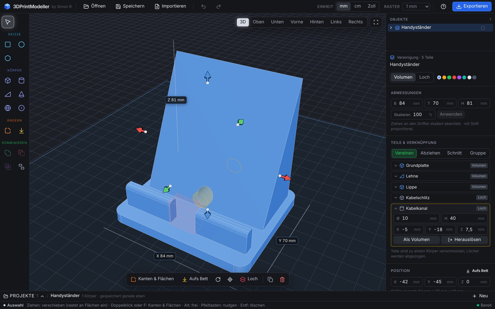
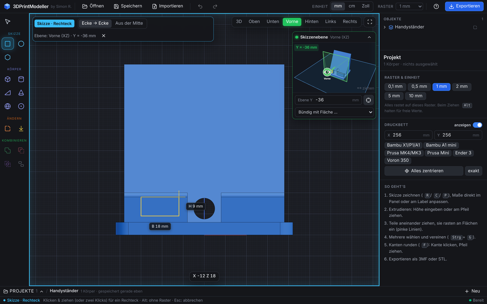
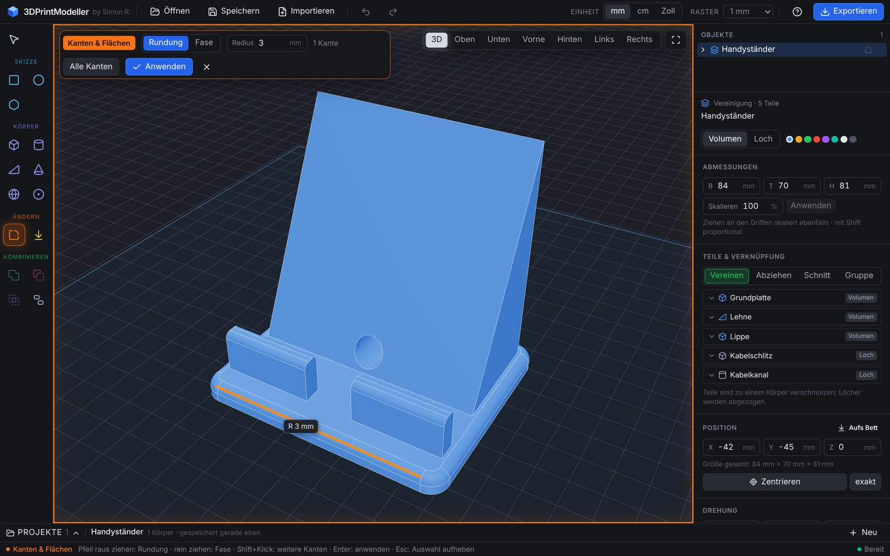
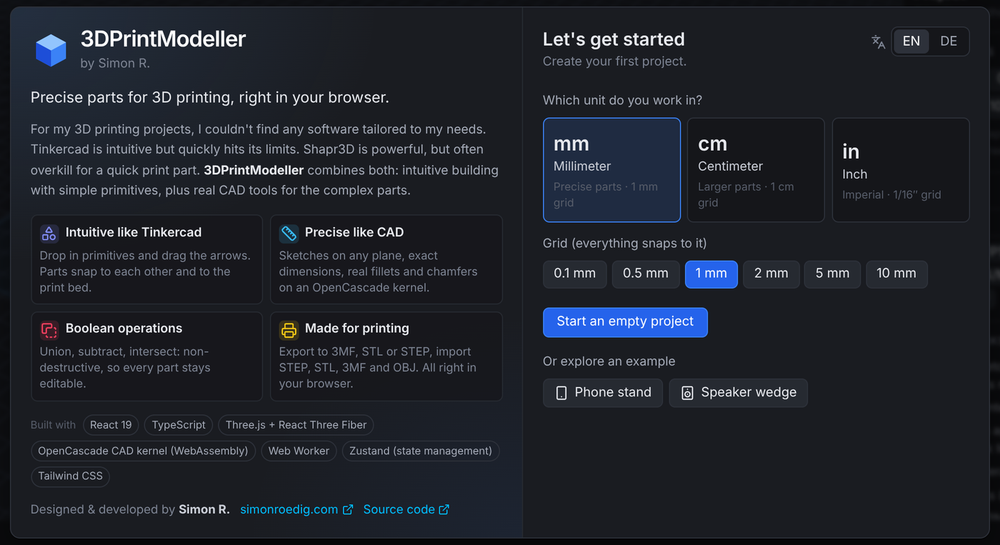

<p align="center">
  
</p>

<h1 align="center">3DPrintModeller</h1>

<p align="center">
  <b>Präzise Teile für den 3D-Druck, direkt im Browser.</b><br />
  So intuitiv wie Tinkercad, so genau wie echtes CAD.
</p>

<p align="center">
  
  
  
  
  
  
  <a href="https://github.com/simonroedig/3DPrintModeller/actions/workflows/ci.yml"></a>
</p>

<p align="center">
  <a href="#warum">Warum?</a> ·
  <a href="#funktionen">Funktionen</a> ·
  <a href="#beispiel-handyständer">Beispiel</a> ·
  <a href="#schnellstart">Schnellstart</a> ·
  <a href="#technik">Technik</a> ·
  <a href="https://simonroedig.com">simonroedig.com</a>
</p>



<p align="center"><sub>Der Beispiel-Handyständer: aus einfachen Grundkörpern gebaut, Kabelkanal und Kabelschlitz abgezogen (der Kanal ist orange markiert), Ecken gerundet. Jedes Teil bleibt änderbar.</sub></p>

## Warum?

Für meine 3D-Druck-Projekte gab es keine Software, die genau auf meine Bedürfnisse zugeschnitten war.
Tinkercad ist intuitiv, stößt aber schnell an Grenzen. Shapr3D ist mächtig, für ein schnelles Druckteil aber oft zu viel.
**3DPrintModeller verbindet beides**: intuitives Bauen mit einfachen Grundkörpern und echte CAD-Werkzeuge für die komplexen Teile.
Alles läuft im Browser, ohne Installation und ohne Konto.

| Das Einfache, wie bei Tinkercad | Das Präzise, wie in CAD-Programmen wie Shapr3D |
| --- | --- |
| Grundkörper per Klick: Quader, Zylinder, Keil, Kegel, Kugel, Rohr | Skizzen auf jeder Ebene, auch direkt auf Flächen anderer Teile |
| Teile ziehen, sie rasten an Flächen und am Druckbett ein | Exakte Maße, Eingabe mit Rechnungen wie `120/2` oder `2cm+5` |
| Löcher sind einfach Körper, die abgezogen werden | Echte Rundungen und Fasen auf einem B-Rep-CAD-Kern (OpenCascade) |
| Griffe an jeder Seite zum Ziehen der Maße | Flächen verschieben und neigen, auch an vereinten Teilen |
| Sofort loslegen, Beispiele im Startdialog | Nicht-destruktive Boolesche Operationen, STEP-Import und -Export |

## Funktionen

### Bauen
- **Einheit und Raster** beim Start wählen (mm, cm, Zoll). Alles rastet auf das Raster, `Alt` beim Ziehen hebt das auf.
- **Grundkörper**: Quader, Zylinder, Keil (mit Winkel), Kegel, Kugel, Rohr. Mit `Shift` direkt als Loch.
- **Verschieben mit Einrasten** an Flächen anderer Körper (bündig, anliegend, mittig) und am Druckbett, pinke Hilfslinien zeigen woran.
- **Griffe als Pfeile** in der Farbe ihrer Achse (X rot, Y grün, Z blau), Maß-Labels direkt im Modell editierbar.
- **Drehen** in 90°-Schritten oder frei, **Fläche aufs Bett legen** per Klick, **Zentrieren** auf dem Druckbett (im Raster oder exakt),
  **Ausrichten** mehrerer Teile.

### Skizzieren in jeder Ebene



- Rechteck, Kreis und Polygon, gezeichnet in der Ebene der aktuellen Ansicht: Oben, Unten, Vorne, Hinten, Links, Rechts
  (in 3D auf dem Boden).
- **Ebenen-Vorschau oben rechts**: ein kleines 3D-Bild zeigt, wo die Skizze im Raum liegt, ein Auge in der Achsfarbe zeigt,
  von wo du schaust. Ziehen verschiebt die Ebene live und rastet bündig an Flächen ein. Oder eine Fläche anklicken,
  dann liegt die Skizze genau darauf.
- **Extrudieren** per Eingabe oder am Pfeil, auch direkt als Loch.

### Kanten und Flächen



- `F` oder Doppelklick auf einen Körper: Kanten und Flächen leuchten beim Darüberfahren auf.
- **Kante**: Pfeil nach außen ziehen ergibt eine Rundung, nach innen eine Fase. Klappt auch an den Übergängen vereinter Teile.
- **Fläche**: verschieben (nach außen oder innen) oder um eine Kante neigen.
- Alles bleibt als Bearbeitungsschritt im Panel änderbar oder entfernbar.

### Kombinieren
- **Vereinen** zu einem echten Körper, **Abziehen** (der zuerst gewählte Körper ist die Basis), **Schnittmenge** und reines **Gruppieren**.
- **Nicht-destruktiv**: abgezogene Werkzeuge bleiben unsichtbar erhalten und lassen sich im Panel aufklappen, ändern, tauschen
  oder herauslösen.
- Kombinierte Körper sind **skalierbar** (Griffe, Maße oder Prozent), parametrisch: runde Teile bleiben rund, alles bleibt exakt.

### Für den Druck
- **Export** als 3MF (empfohlen), STL oder STEP, mit wählbarer Qualität, wasserdichtem Netz und Volumen- und Gewichtsschätzung.
- **Import** von STEP (exakt), STL, 3MF und OBJ. Netze werden in CAD-Körper umgewandelt (ebene Bereiche werden echte Flächen),
  sehr große Netze bleiben schnelle Mesh-Objekte.
- **Druckbett** mit Presets (Bambu, Prusa, Ender, Voron), ein- und ausblendbar.

### Komfort
- **Projekte** in einer einklappbaren Leiste unten, mit Vorschaubild, automatisch im Browser gespeichert (IndexedDB).
- **Kontextleiste** zur Auswahl mit den nächsten sinnvollen Schritten, **Tooltips** mit Tastenkürzeln an allen Buttons.
- **Farben mit Bedeutung**: Skizze hellblau, Körper indigo, Kanten und Flächen orange, Vereinen grün, Abziehen rot, Schnittmenge lila.
- Rückgängig und Wiederholen, Kopieren und Einfügen, lange Berechnungen lassen sich abbrechen.

## Beispiel: Handyständer

Im Startdialog unter **„Oder ein Beispiel ansehen“** lässt sich der Handyständer aus dem Bild oben öffnen.
Er zeigt den typischen Ablauf:

1. **Grundplatte**: ein Quader, 84 × 70 × 6 mm.
2. **Lehne**: ein Keil, der auf etwa 65° ansteigt.
3. **Lippe**: ein flacher Quader vorne, damit das Handy nicht wegrutscht.
4. **Kabelschlitz** und **Kabelkanal**: ein Quader und ein gedrehter Zylinder, beide als Loch.
5. **Vereinen**: alles wird ein Körper, die Löcher werden abgezogen.
6. **Kanten runden**: Ecken der Platte und Oberkante der Lippe.
7. **Exportieren** als 3MF und drucken.

Jeder Schritt bleibt änderbar: Teil im Panel aufklappen, Maße anpassen, fertig.

## Bedienung

| Taste | Aktion |
| --- | --- |
| `V` | Auswählen und verschieben |
| `R` / `C` / `P` | Rechteck / Kreis / Polygon |
| `F` | Kanten und Flächen bearbeiten |
| `L` | Fläche aufs Bett legen |
| `1` bis `6`, `7` | 3D, Oben, Vorne, Hinten, Links, Rechts, Unten |
| `Leertaste` / `0` | Oben und 3D wechseln / alles einpassen |
| `Strg+G` / `Strg+Shift+G` | Vereinen / Trennen |
| `M` / `Shift+M` | Mittig aufs Bett (im Raster / exakt) |
| `Q` / `E` | 90° um Z drehen |
| `H` | Volumen oder Loch |
| `Strg+D`, `Strg+C`, `Strg+V` | Duplizieren, Kopieren, Einfügen |
| `Strg+Z` / `Strg+Shift+Z` | Rückgängig / Wiederholen |
| Pfeiltasten, Bild ↑↓ | Auswahl um einen Rasterschritt verschieben (`Shift` ×10) |
| `Esc` | Abbrechen, Werkzeug beenden |

Maus: links auswählen, ziehen und zeichnen, rechte Taste halten zum Drehen (aus einer 2D-Ansicht geht es direkt in 3D weiter),
mittlere Taste verschieben, Mausrad zoomen.

## Schnellstart

Voraussetzung: Node.js 22 (mindestens 20.19).

```bash
git clone https://github.com/simonroedig/3DPrintModeller.git
cd 3DPrintModeller
npm install
npm run dev       # http://localhost:5173
```

```bash
npm run build     # Typecheck und Produktions-Build nach dist/
npm run preview   # Build lokal ansehen
```

## Technik

| Bereich | Technologie |
| --- | --- |
| Oberfläche | React 19, TypeScript, Tailwind CSS 4, lucide-react |
| 3D-Ansicht | Three.js, React Three Fiber, drei |
| CAD-Kern | OpenCascade als WebAssembly über [replicad](https://replicad.xyz), in einem Web Worker |
| Zustand | Zustand, Rückgängig und Wiederholen über Dokument-Snapshots |
| Speicher | IndexedDB (Projekte, Vorschaubilder, importierte Dateien) |
| Build | Vite 8 |
| Export | eigener 3MF-Writer (fflate), binäres STL, STEP über OpenCascade |

Ein paar Details:

- **Parametrisches Modell**: Jeder Körper ist eine Form mit Parametern plus eine Liste von Bearbeitungsschritten
  (Rundung, Fase, Fläche verschieben oder neigen). Die Schritte merken sich ihre Kanten und Flächen geometrisch,
  deshalb überleben sie Änderungen davor.
- **CAD im Hintergrund**: Der OpenCascade-Kern rechnet in einem Web Worker mit einer Warteschlange. Netze werden nach Geometrie
  zwischengespeichert, lange Berechnungen lassen sich abbrechen (der Worker startet dann neu).
- **Robuste Rundungen**: Gelingt eine Rundung nicht auf einmal, wird Kante für Kante versucht und notfalls ein eigenes Profil
  verrundet. So klappen auch Übergänge zwischen vereinten Teilen.
- **Import**: STEP wird exakt gelesen. Dreiecksnetze bis etwa 12.000 Dreiecke werden in ebene Bereiche zerlegt, zu Flächen
  vernäht und zu Volumenkörpern repariert. Größere Netze bleiben Mesh-Objekte und werden direkt angezeigt.
- **Ebenen-Vorschau**: wird im selben WebGL-Kontext in einen Ausschnitt gerendert (Scissor), ohne zweiten Canvas.

```
src/
  cad/        CAD-Worker (OpenCascade), Mesh-Cache, Import, STL/3MF-Writer
  store/      Dokument, Auswahl, Undo/Redo, Modell-Operationen, Projekte
  lib/        Einheiten, Ebenen, Geometrie, Einrasten, Skalieren
  viewport/   3D-Ansicht: Kameras, Körper, Skizzen, Griffe, Kanten-Werkzeug, Vorschau
  ui/         Werkzeugleiste, Panels, Dialoge, Tastenkürzel
```

## Deployment

Eine rein statische Seite mit relativen Pfaden, läuft auf jedem statischen Hoster.
Gehostet wird sie auf **Vercel**: Framework-Preset **Vite**, Build-Befehl `npm run build`, Ausgabeordner `dist`.
Netlify oder GitHub Pages funktionieren genauso.

Bei jedem Push auf `main` und bei Pull Requests prüft GitHub Actions Typecheck und Build (`.github/workflows/ci.yml`).

## Autor

Entworfen und entwickelt von **Simon R.**, [simonroedig.com](https://simonroedig.com).


